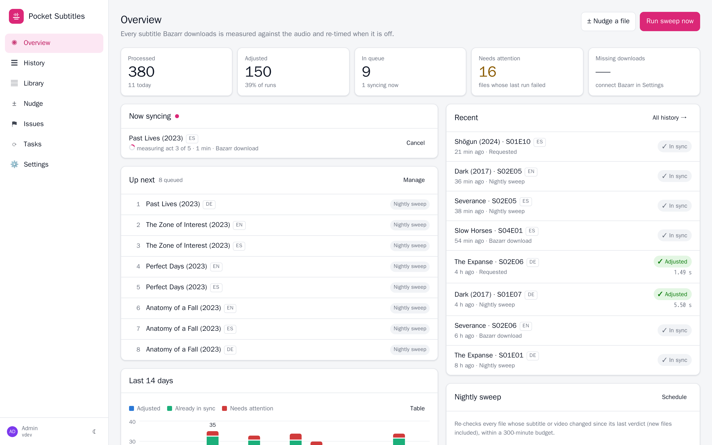
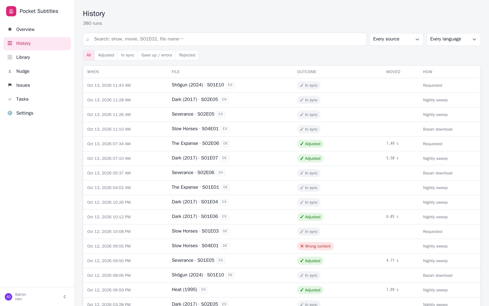
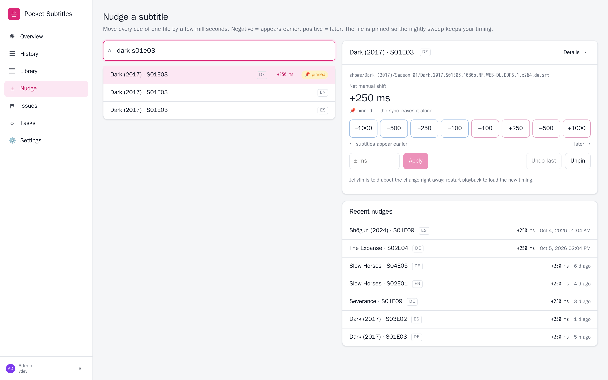
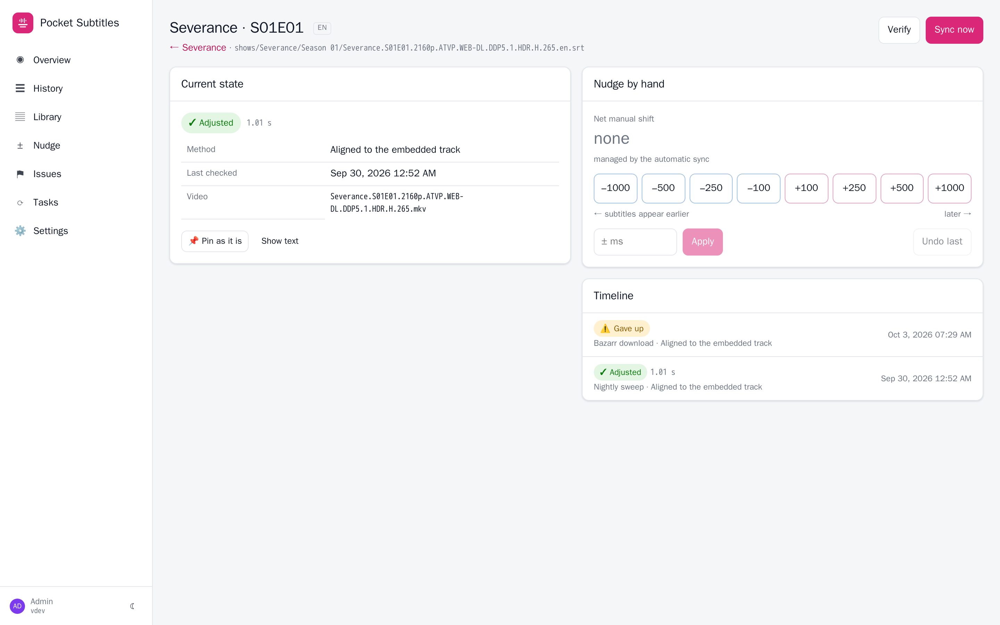
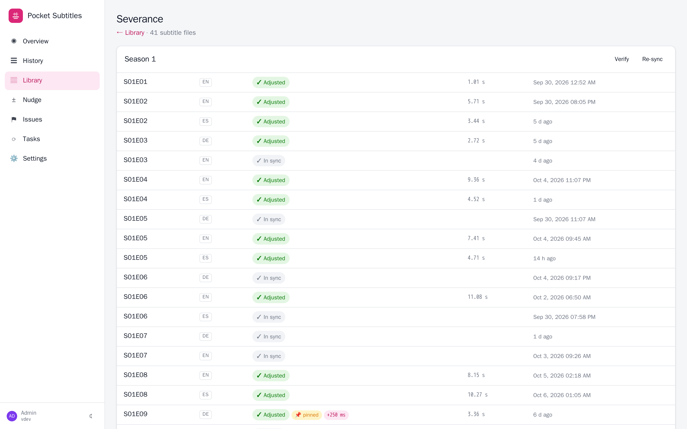
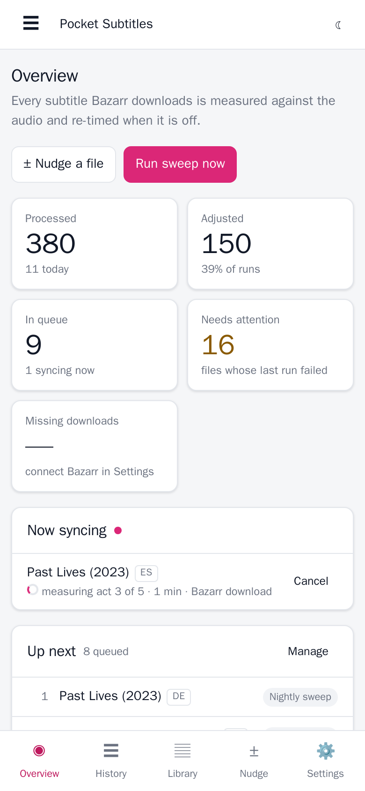
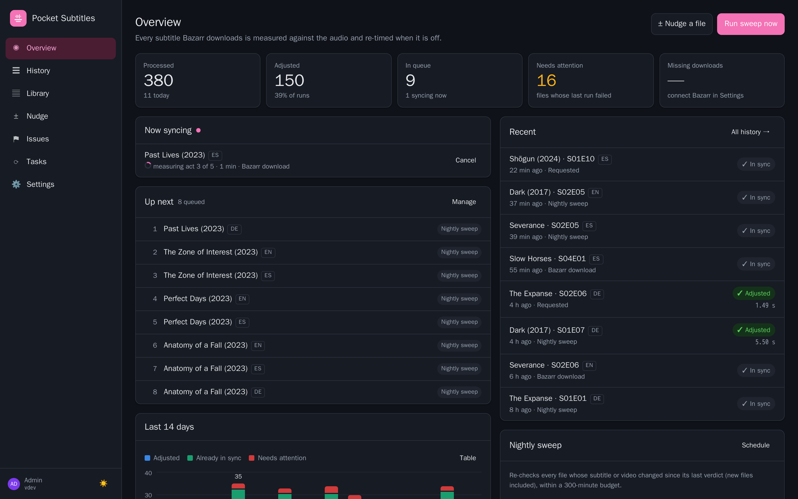

<p align="center">
  
</p>
<h1 align="center">Pocket Subtitles</h1>
<p align="center">
  Keeps your library's subtitles in sync with the audio — every download from Bazarr re-timed automatically, the library swept every night, any file nudged by hand.<br>
  <b>One container · one SQLite file · one volume.</b>
</p>
<p align="center">
  <a href="https://github.com/abjelosevic88/pocket-homelab-subtitles/actions"></a>
  <a href="https://github.com/abjelosevic88/pocket-homelab-subtitles/pkgs/container/pocket-homelab-subtitles"></a>
  <a href="LICENSE"></a>
</p>

---

Bazarr finds subtitles. Whether they line up with *your* release is another matter: a different cut, a recap that isn't there, a TV rip timed against a Blu-ray. Bazarr's built-in sync is one global shift, and it happily "syncs" a subtitle for the wrong episode. This is what grew out of fixing that for a real library, packaged so anyone can run it:

- **Measure first, act only when sure, never make a file worse.** Each download is measured against the video's own audio — and against its embedded English track when that track proves it matches the audio. A file already in sync is not touched.
- **Different cuts are handled.** Alignment to a trusted embedded track follows any number of inserted or missing scenes ([alass](https://github.com/kaegi/alass)); otherwise the audio is aligned act by act (black-frame boundaries), with every act checked against the whole-file answer so a quiet scene can't drag it somewhere wrong.
- **Wrong subtitles are caught, not synced.** After alignment the cues must sit on detected speech; a subtitle for another episode fails that and is rejected — with Bazarr connected, that upload is blacklisted and a replacement searched for. Machine translations of fresh downloads are rejected too (tuned for Serbian, Croatian and Bosnian).
- **You stay in control.** See every verdict with its reasons, nudge a file by ±milliseconds (it is pinned so nothing undoes your timing), restore the original download, re-sync or verify a whole season, or reset it through Bazarr.

<p align="center"></p>

<table>
  <tr>
    <td width="50%"></td>
    <td width="50%"></td>
  </tr>
  <tr>
    <td align="center"><sub>Every run, searchable, with the engine's reasons.</sub></td>
    <td align="center"><sub>Nudge any file by hand. Undo, unpin.</sub></td>
  </tr>
  <tr>
    <td width="50%"></td>
    <td width="50%"></td>
  </tr>
  <tr>
    <td align="center"><sub>One file: verdict, timeline, restore the original.</sub></td>
    <td align="center"><sub>A show by season: verify, re-sync, reset.</sub></td>
  </tr>
</table>

<p align="center">
  &nbsp;&nbsp;
  <br>
  <sub>Installable PWA with a bottom tab bar, plus dark mode.</sub>
</p>

## Features

| Area | What you get |
|---|---|
| **Automatic sync** | Bazarr's post-processing hands every download to the queue (one `curl`, it returns at once). One file is synced at a time, at low CPU priority. Reading lead (cues land N ms after the voice), centre-channel speech detection on 5.1 audio, a polish pass for short displaced blocks. |
| **Quality gates** | Wrong-content rejection (cues must cover the detected speech, relative to the video's own track), machine-translation rejection, Serbian Cyrillic → Latin conversion. On rejection: blacklist in Bazarr and fetch another, move it out, or just flag it. |
| **Nightly sweep** | Checks every file whose subtitle or video changed since its last verdict — including subtitles that never came through Bazarr — within a time budget. Unchanged files are skipped, so it costs nothing on a quiet night. |
| **Overview** | Processed / adjusted / queue / needs attention / missing downloads, what is syncing now and at which stage, what is next, 14 days of activity. |
| **History** | Every run with outcome, how far the file moved, method, speech reference, content fit, act-by-act offsets and the raw engine output. Filter by outcome, source, language. |
| **Library** | Shows and movies with their files per season, last verdict, pins and nudges. Per file: sync now, verify against the audio, pin, restore the original download, read the text, full timeline. |
| **Nudge** | Shift one file by milliseconds (quick ±100…1000 or any value), undo, unpin. Pinned so the sweep keeps your timing. Jellyfin is told immediately. |
| **Season tools** | Verify (independent whole-file check of every file), Re-sync (optionally with fresh audio references), Reset through Bazarr (back up, delete, download again with manual provider search and a preferred provider, sync, de-duplicate, verify; anything no provider has any more is restored). |
| **Issues** | Files that need attention, rejected downloads (put one back with a click), Bazarr's missing list with *search now*. |
| **Integrations** | Bazarr (wanted counts, blacklist, season tools), Jellyfin/Emby folder refresh, notifications via Apprise, ntfy or a webhook. Path mappings when containers see the library differently. |
| **Users** | Built-in login (admin/member), or trust your SSO proxy's header, or no login on a trusted LAN. Personal API tokens. |
| **Data** | SQLite backup from the UI/CLI/API, Prometheus `/metrics`, a Homepage-ready `/api/v1/widget`. The first original of every changed file is kept forever. |

## Run it

```bash
mkdir pocket-subtitles && cd pocket-subtitles
curl -fsSLO https://raw.githubusercontent.com/abjelosevic88/pocket-homelab-subtitles/main/docker-compose.yml
# edit the media volume: mount your library at the same path Bazarr sees it (e.g. /media)
docker compose up -d
# open http://localhost:8080 and create your account
```

Then **connect Bazarr** (Settings → Integrations shows the exact command with a token filled in):

1. In Pocket Subtitles: Settings → Integrations → *Create a token for Bazarr*, set the URL Bazarr reaches the app at, *Copy command*.
2. In Bazarr: Settings → Subtitles → **Custom post-processing** on, paste the command. Turn Bazarr's own *Automatic subtitles synchronization* off.
3. Optional: Bazarr URL + API key (missing list, blacklisting, season tools) and Jellyfin URL + API key (instant refresh).

Want to look around first? `docker run --rm -p 8080:8080 -e DEMO_DATA=true -e AUTH_MODE=none ghcr.io/abjelosevic88/pocket-homelab-subtitles` serves a sample library with no login.

More in [docs/bazarr.md](docs/bazarr.md) (hook, path mapping, season tools) and [docs/how-it-works.md](docs/how-it-works.md) (what the engine measures and why).

## Configuration

Runtime behaviour (reading lead, gates, schedule, integrations, notifications) is edited under **Settings** and stored in the database. The environment covers the rest:

| Variable | Default | Notes |
|---|---|---|
| `TZ` | `UTC` | The nightly sweep runs on this clock. Set it. |
| `MEDIA_DIRS` | `/media` | Library folders, comma separated (e.g. `/media/shows,/media/movies`). The first folder below each is the show or movie. |
| `DATA_DIR` | `/data` | Database, measurement cache, original backups, rejected copies. |
| `AUTH_MODE` | `local` | `local`, `proxy` (trust `Remote-User`), or `none` (trusted LAN only). |
| `ADMIN_EMAIL` / `ADMIN_PASSWORD` | – | Create the first admin without the setup screen. |
| `SECURE_COOKIES` | `false` | `true` behind HTTPS. |
| `BAZARR_URL` / `BAZARR_API_KEY` | – | Seed the Bazarr integration (also settable in the UI). `*_FILE` variants read Docker secrets. |
| `JELLYFIN_URL` / `JELLYFIN_API_KEY` / `JELLYFIN_PATH_MAP` | – | Seed the Jellyfin integration. |
| `WORKERS` | `1` | Files synced in parallel. Each decodes a whole video's audio. |
| `NICE` | `19` | CPU priority of the engine — playback and transcoding win. |
| `JOB_TIMEOUT` | `1h` | Give up on one file after this long. |
| `LEGACY_API` | `off` | Serve the endpoints of the old `sync-status-server` (see [docs/migrating.md](docs/migrating.md)). |
| `DEMO_DATA` | `false` | Seed a sample library into an empty database. |

The full list is in [docs/configuration.md](docs/configuration.md).

## Automation

Create a token under **Settings → API tokens**, then:

```bash
# queue one file (path as the container sees it)
curl -X POST https://subs.example.com/api/v1/sync -H "Authorization: Bearer pst_…" \
  -H "Content-Type: application/json" -d '{"path":"/media/shows/Dark (2017)/Season 01/Dark.S01E01.en.srt"}'

# compact status for a Homepage customapi widget
curl -H "Authorization: Bearer pst_…" https://subs.example.com/api/v1/widget
# → {"status":"syncing","now":"Dark (2017) S01E03","queued":4,"missing":12,"attention":2,"items":[…]}
```

Everything else is in [docs/api.md](docs/api.md).

## Backups

- **Database:** Settings → Backup & data → *Download database*, `docker exec pocket-subtitles pocket-subtitles backup`, or `GET /api/v1/backup` — a consistent `VACUUM INTO` copy.
- **`DATA_DIR/backups`** holds the first original of every subtitle the app changed (mirroring the library tree) and every nudge's undo copy. Back it up with the database.
- **`DATA_DIR/cache`** holds per-video speech references. It is rebuildable but expensive (a full audio decode per video), so keep it if you can.

See [docs/backup.md](docs/backup.md).

## How it is built

A Go server (chi, modernc SQLite — no CGO) owns the queue, history, schedule and integrations, and serves a React 19 + Vite UI. The measuring is done by a Python engine ([engine/pocket_sync.py](engine/pocket_sync.py)) on top of [ffsubsync](https://github.com/smacke/ffsubsync), [alass](https://github.com/kaegi/alass) and ffmpeg, all inside the image. The engine never deletes files and never talks to the network; the server decides what happens to a rejected file.

```bash
make dev      # Go API on :8080 (demo data, no login) + Vite on :5173
make test     # go vet + go test + engine tests + tsc
make docker   # the image, engine included
```

Planned next steps are in [docs/roadmap.md](docs/roadmap.md). Sibling projects: Pocket Habits, Pocket Inventory, Pocket Bookshelf, Pocket Split and Pocket Invoicing.
